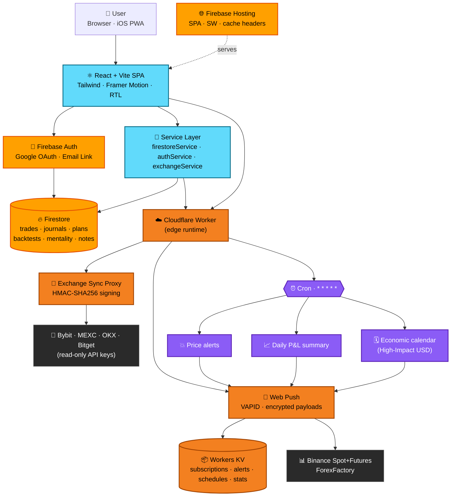
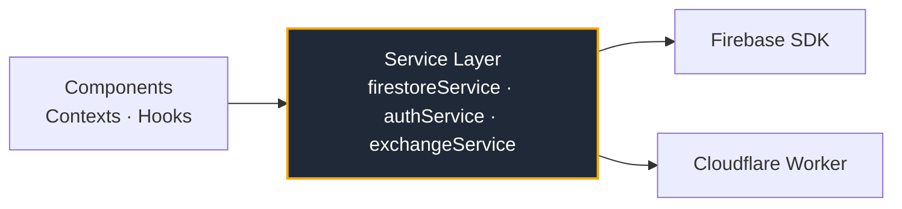

<div align="center">


<br/>


</div>

# TradeOS — Trading Operating System

<div dir="rtl">

פלטפורמה מקיפה לניהול מסחר בקריפטו (פיוצ'רס) — יומן מסחר, אנליטיקס מתקדם, אזור מנטליות, חיבור בורסות, התראות Web Push מתוך האפליקציה, ועוד. הכל בעברית ובממשק RTL מודרני.

</div>

**Live:** [tradeos-91a58.web.app](https://tradeos-91a58.web.app)

---

## Features

### Trading Journal
- Log futures trades with entry/exit prices, leverage, fees, and notes
- Automatic P&L, ROI%, R:R, and net PnL calculations
- Filter by pair, strategy, result, tag — **filters persist across page reloads**
- Multiple journals per exchange/strategy
- Monthly calendar with color-coded daily P&L
- CSV import (Bybit / MEXC / OKX / Bitget format) + CSV export with correct % calculation
- **Duplicate trade detection** — warns if a similar trade already exists
- **Undo delete** — 5-second undo window with batched toast notifications

### Exchange Sync
- **Direct API sync** from Bybit, MEXC, OKX, Bitget — no manual CSV needed
- Accurate **entry & exit timestamps** (MEXC: dual-API chronological matching)
- Syncs fees, leverage, direction, P&L from exchange
- **Upsert logic** — re-sync updates existing trades instead of creating duplicates
- Passphrase support for OKX and Bitget
- **MT5** — CSV import with step-by-step guide
- **Binance** — guide only (IP whitelist limitation)
- Visual preview of trades before import, with "update" badge for existing ones

### Dashboard & Analytics
- P&L chart, win rate breakdown, equity curve
- Trade heatmap, streak analysis, **day-of-week** performance
- **Session analysis** using Israel timezone (Asia/Jerusalem) — Asian/London/NY/Overlap
- Correlation heatmap between pairs
- Monthly performance table, strategy comparison
- Sharpe Ratio, Sortino Ratio, Profit Factor, Calmar Ratio, Max Drawdown, Recovery Factor
- Live crypto price ticker, Fear & Greed gauge
- **Offline detection banner** — alerts user when internet is lost

### Mentality Zone
- Morning & evening psychological journals
- Emotion tracking, readiness assessment
- Psychological journey timeline
- Mental stats with streaks and patterns

### Backtesting
- Separate journals for strategy backtesting
- Side-by-side strategy comparison
- Auto-detected trading sessions
- Backtest-specific analytics

### DCA Tracker
- Dollar-cost averaging position tracker
- Per-coin analytics with average entry price
- Portfolio summary

### Market Data
- Real-time prices: market cap, BTC dominance, 24h volume
- Fear & Greed Index with history
- Altcoin Season Index (90-day)
- Top gainers/losers, trending coins, interactive heatmap
- Crypto news feed + economic calendar

### Plans & Analysis
- Trading plans with entry/exit rules and TradingView chart links
- Analysis cards with coin filter (substring search) and category filter
- Custom strategy management per context

### Additional
- Personal trading notes
- Global search across trades, plans, backtests
- Dark/Light mode with persistent preference
- Mobile responsive with bottom navigation and pull-to-refresh
- Onboarding wizard for new users

---

## Notifications (Web Push)

All notifications are delivered in-app via Web Push (VAPID), keyed by the user's uid — no external bot or third-party chat app required. Everything is configured from the app's notification settings.

### Automated Notifications
| Feature | Description |
|---|---|
| Price Alerts | Set target prices in the Market screen, monitored 24/7 by the cron |
| Trade Events | Position opened / TP hit / SL hit (manual trades and exchange sync) |
| Journal Reminder | Daily reminder at configurable time (default 21:00) |
| Daily Summary | End-of-day P&L, trade count, Win Rate (auto-pushed from app) |
| Economic Calendar | Alert 1 hour before High Impact USD events (CPI, FOMC, NFP) |

### Worker Architecture
- **Runtime:** Cloudflare Workers (serverless, edge)
- **Delivery:** Web Push (VAPID, encrypted payloads) to every registered device
- **Storage:** Workers KV (push subscriptions, alerts, schedules, stats — all uid-keyed)
- **Market Data:** Binance Spot + Futures API
- **Calendar:** ForexFactory API
- **Cron:** Every 10 minutes (price alerts, reminders, summaries, calendar events)
- **Exchange Sync:** HMAC-SHA256 signing proxy — API secrets never leave the server

---

## Tech Stack

### Web App
| Technology | Version | Usage |
|---|---|---|
| React | 19 | UI framework |
| Vite | 7 | Build tool |
| Tailwind CSS | 4 | Styling |
| Firebase Auth | 12 | Authentication (Google) |
| Cloud Firestore | 12 | Database |
| Firebase Hosting | — | Deployment |
| Recharts | 3.8 | Charts & graphs |
| Framer Motion | 12 | Animations |
| Lucide React | — | Icons |
| React Hot Toast | — | Notifications |
| date-fns | — | Date handling |

### Cloudflare Worker
| Technology | Usage |
|---|---|
| Cloudflare Workers | Serverless runtime (Web Push notifications + Exchange sync proxy) |
| Workers KV | Key-value storage for push subscriptions, alerts, schedules |
| Web Push (VAPID) | Encrypted push delivery to registered devices |
| Binance API | Spot + Futures market data |
| MEXC / Bybit / OKX / Bitget API | Exchange trade sync (read-only, HMAC signed) |

---

## Architecture



All Firebase SDK calls are isolated in a **service layer** (`src/services/`). Hooks and components never import directly from `firebase/*` — they use service functions instead.



---

## Project Structure

```
TradeOS/
├── src/
│   ├── components/
│   │   ├── analytics/       # Advanced stats, equity curve, heatmap, streaks
│   │   ├── auth/            # Login page
│   │   ├── backtest/        # Backtesting tracker & analytics
│   │   ├── dashboard/       # Dashboard, stat cards, charts, performance tables
│   │   ├── dca/             # DCA position tracker & analytics
│   │   ├── exchange/        # Exchange API settings & sync UI
│   │   ├── journal/         # Trade journal, calendar, form, filters
│   │   ├── layout/          # Header, sidebar, mobile nav
│   │   ├── leaderboard/     # User rankings
│   │   ├── market/          # Market overview
│   │   ├── mentality/       # Morning/evening journals, mental stats
│   │   ├── news/            # News feed + economic calendar
│   │   ├── notes/           # Trading notes
│   │   ├── onboarding/      # First-time user wizard
│   │   ├── plans/           # Trading plans & analysis cards
│   │   ├── profile/         # User profile, notification settings
│   │   ├── shared/          # Reusable UI components
│   │   └── strategies/      # Custom strategy management
│   ├── contexts/            # React contexts (Auth, Journal, Backtest)
│   ├── hooks/               # Custom hooks (trades, stats, DCA, alerts, etc.)
│   ├── services/            # Firebase, Firestore, push, exchange APIs
│   └── utils/               # Calculations, formatters, constants
├── worker/
│   └── index.js             # Cloudflare Worker (Web Push + exchange sync proxy)
├── public/                  # Static assets & icons
└── package.json
```

---

## Getting Started

### Prerequisites
- Node.js 18+
- Firebase project (Auth + Firestore enabled)
- Cloudflare account (for Worker)

### Web App

```bash
# Install dependencies
npm install

# Create .env with Firebase config
cp .env.example .env

# Start dev server
npm run dev

# Build & deploy
npm run deploy
```

### Environment Variables

```env
VITE_FIREBASE_API_KEY=
VITE_FIREBASE_AUTH_DOMAIN=
VITE_FIREBASE_PROJECT_ID=
VITE_FIREBASE_STORAGE_BUCKET=
VITE_FIREBASE_MESSAGING_SENDER_ID=
VITE_FIREBASE_APP_ID=
VITE_WORKER_URL=https://your-worker.workers.dev
```

### Cloudflare Worker

```bash
# Login to Cloudflare
npx wrangler login

# Set the Web Push VAPID key as a secret
npx wrangler secret put VAPID_JWK

# Deploy
npx wrangler deploy
```

---

## Supported Exchanges

| Exchange | API Sync | CSV Import | Notes |
|---|---|---|---|
| MEXC | ✅ | ✅ | Dual-API exit time matching |
| Bybit | ✅ | ✅ | Closed PnL endpoint |
| OKX | ✅ | ✅ | Requires Passphrase |
| Bitget | ✅ | ✅ | Requires Passphrase |
| Binance | ❌ | ✅ | IP whitelist limitation |
| MetaTrader 5 | ❌ | ✅ | CSV export from History Center |

API keys are **read-only** and signed server-side via the Cloudflare Worker — secrets never reach the browser.

---

## Deployment & Release Workflow

### How to ship any change

```bash
git pull origin main          # get the latest
# ...make your changes...
npm run deploy                # build + worker + hosting + Firestore rules
```

`npm run deploy` runs: `vite build` → `wrangler deploy` (Cloudflare Worker) →
`firebase deploy --only hosting,firestore:rules`. Firestore security rules are
published automatically, so rule changes never get left behind.

### Version bump — required on every release

Two values must be bumped together so users reliably receive the update:

| File | Constant | Why |
|---|---|---|
| `src/utils/constants.js` | `APP_VERSION` | Shown in the sidebar; how you confirm a device's version |
| `public/sw.js` | `CACHE_NAME` (`tradeos-vN`) | Forces the service worker to register a new version |

Bump `APP_VERSION` (e.g. `1.0.0` → `1.0.1`) and increment `CACHE_NAME`
(`tradeos-v12` → `tradeos-v13`) in the same commit as your change.

### In-app update prompt (how users get updates)

Users are **never** force-reloaded. The flow:

1. You deploy a new version (new `CACHE_NAME`).
2. The browser downloads the new service worker in the background.
3. The new version **waits** — it does not take over. `sw.js` deliberately
   does not call `skipWaiting()` on install.
4. The app detects the waiting version and shows the banner
   *"גרסה חדשה זמינה — עדכן עכשיו"* (`src/components/shared/UpdatePrompt.jsx`).
5. The user clicks update → the app posts `SKIP_WAITING` to the SW → the SW
   activates → the page reloads **once** (guarded against reload loops in
   `src/services/swUpdate.js`).
6. First-time installs never show the banner (it's not an "update").

The very first deploy after introducing this flow still updates the old way
(close/reopen). Every deploy after that shows the banner automatically.

### Rollback (bad deploy safety net)

A bad release can be reverted in seconds without a redeploy:
[Firebase Hosting → Release history](https://console.firebase.google.com/project/tradeos-91a58/hosting)
→ pick the last good version → **Rollback**. End users cannot downgrade
themselves; version control is centralized with the project owner.

### Admin panel

Route `/admin` (sidebar link "ניהול") is gated on the user's Firestore
profile having `role: "admin"`. It is read-only. To grant the first admin
(chicken-and-egg, since rules require `role` to read other users), set the
`role` field to `admin` on your own document under `users/{uid}` in the
[Firestore console](https://console.firebase.google.com/project/tradeos-91a58/firestore)
once.

### AI agent checklist (do this for every code change)

1. Branch/work on `main` unless told otherwise; commit with the project
   owner's git identity (`Avraham Niazov <aviniazov7@icloud.com>`), no
   third-party trailers in commit messages.
2. Make the change. Keep Firebase access inside `src/services/`.
3. Bump `APP_VERSION` in `src/utils/constants.js` **and** `CACHE_NAME`
   in `public/sw.js`.
4. `npm run build` must pass. Pre-existing lint errors (duplicate keys,
   `worker/index.js`, `motion`/JSX false-positives) are not deploy blockers;
   do not add new ones in changed files.
5. Commit + `git push origin main`.
6. Tell the owner to run `git pull origin main && npm run deploy`.
   (The remote sandbox cannot deploy — no Firebase/Cloudflare credentials.)

---

## License

Private project. All rights reserved.
