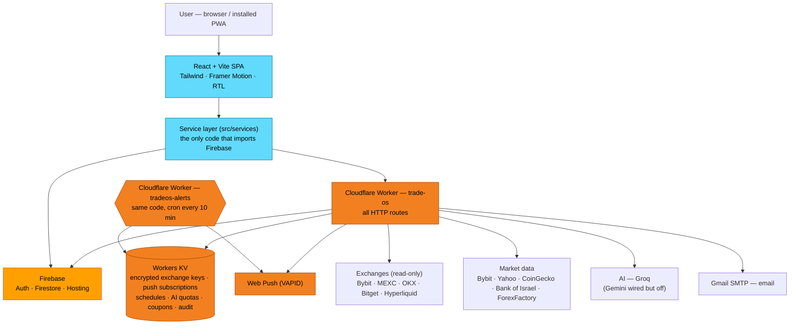

<div align="center">


<br/>


</div>

# TradeOS — Trading Operating System

A trading journal and analytics platform for crypto, stocks and futures traders: trade journal with R-multiples, live exchange sync, a live trading desk, backtesting, a psychology journal, market data, an AI coach and Web Push alerts. The product UI is **Hebrew, right-to-left** (this repository's documentation is in English, except the internal hand-over notes in `docs/NEXT.md` and `docs/VERSIONING.md`).

**Live:** [https://tradeoslive.web.app](https://tradeoslive.web.app) · **Working from another machine?** Read [`docs/NEXT.md`](docs/NEXT.md) first (what is open, what shipped) and [`CLAUDE.md`](CLAUDE.md) (the rules for any AI agent or developer). Site ids `tradeos`, `tradeosapp`, and `tradeos-app` are reserved by other Firebase projects, so production uses site `tradeoslive`. The default Hosting site `tradeos-91a58` is not deployed; disable it with `firebase hosting:disable --project tradeos-91a58 --site tradeos-91a58` (it cannot be deleted).

---

## Features

### Trading journal
- Three asset classes — crypto, stocks and CME futures — with their own forms, fees and risk maths. Several journals per user (free plan: 2).
- Single-screen **trade ticket**: entry, stop, targets, scale-in fills, exits with per-target percentages, trade plan checklist and adherence, up to four TradingView chart links (snapshot preview when the link is a `tradingview.com/x/` share), notes, tags, strategy and timeframe memory. Older chart screenshots saved as Firestore data URLs still display, read-only.
- Automatic P&L, ROI, **R-multiple** (against the *original* stop), fees from per-journal **commission presets**, **MAE / MFE** excursion, partial exits and break-even moves.
- Filters (pair, strategy, result, tag, dates) that persist across reloads; monthly calendar with daily P&L; CSV import/export; duplicate detection; 5-second undo for deletes.
- **Prop-firm tracker** (profit target, daily/overall drawdown rules) per journal.
- **Stocks journal** with company logos and live quotes (via the Worker); an **exchange** tab only for crypto journals.
- Entry and exit times can't be set in the future, nor an exit before the entry.

### Exchange sync (read-only)
- Direct API sync from **Bybit, MEXC, OKX, Bitget** and **Hyperliquid** (wallet address only, public data); **Binance** is CSV-only (its API needs a static IP).
- Keys are stored **encrypted on the server** and the app tells users to create **read-only** keys. See [Security](#security--privacy).
- Re-sync upserts existing trades; OKX/Bitget passphrases supported; accurate entry/exit timestamps.

### Open positions (journal tab)
- Live open positions and open orders from the connected exchanges (read-only), on the journal tab "פוזיציות פתוחות".
- `/terminal` redirects there. Chart screenshots are not uploaded; a trade can carry a TradingView link with a snapshot or embed preview.

### Dashboard
- Portfolio value and equity curve, an AI "agent" read of your trades, win rate, win/loss ratio, profit factor, streaks, performance score, recent trades, per-journal cards, market snapshot and news.
- Small samples are shown honestly: no score before 5 closed trades, no win/loss ratio until there is a loss.

### Analytics & backtesting
- Equity, session (Israel time), day-of-week and duration analysis; Sharpe, Sortino, Calmar, drawdown and recovery.
- Separate **backtest journals** with their own analytics and a shareable strategy view.

### Portfolio, plans and tax
- **Portfolio** (`/portfolio`): DCA plans and their performance, plus read-only on-chain wallet balances (EVM, Solana, Bitcoin).
- **Trading plans** with entry/exit rules, checklists and chart links.
- **Tax report**: realised gains in ILS using Bank of Israel exchange rates (linked from the profile).

### Mentality zone
- Morning and evening journals (emotions, sleep, lessons). **They are private to the user — admins cannot read them.**
- A **development map**: a stage assessment built from the user's own trades, plans and journals, with an animated journey path, strengths/blockers and an AI read.

### Market, news and AI
- **Market**: global stats, Fear & Greed, altcoin season, gainers/losers, heatmap, funding / open interest / long-short ratios, a live liquidation stream, coin analysis, whale tracking and Polymarket (Premium). Every panel shows an error state with retry when a source fails.
- **News**: crypto and stocks feeds (machine-translated headlines) and an **economic calendar** with a switch for the "high-impact USD event in an hour" push.
- **TradeAI**: chat, a chart analyzer and the AI coach. Numbers in AI answers stay left-to-right inside Hebrew text; all AI HTML is sanitized.

### Accounts, plans and accessibility
- Google or email sign-in; password policy (8+ chars, an uppercase letter and a digit); an unverified-email reminder; profile photo; complete **account deletion** (see Security).
- **Free / Premium** plans with coupons. Online payments are not live yet — Premium is granted manually or by coupon.
- Light/dark theme, an accessibility menu and statement, installable PWA with silent updates.

---

## Notifications

Everything is **Web Push** (VAPID, encrypted payloads) keyed by user id — no external bot. Users configure them in *Profile → Notifications*; the economic-calendar alert also has a switch on the *News → Economic calendar* tab.

| Alert | When |
|---|---|
| Trade events | position opened / TP hit / SL hit (from exchange sync) |
| Journal reminder | daily, at a time the user picks |
| Daily summary | end-of-day P&L, trade count, win rate |
| Economic calendar | about an hour before a **high-impact USD** event — Hebrew event name, Israel time, forecast, previous value and a volatility warning; opens the calendar |
| Unusual price move | only when price **and** volume break out together and corroborating coverage explains it |
| Premium expiry | 3 days before and on the day |
| Admin messages | one-off or bulk, sent by an admin |

**Email** is limited to service emails (Premium receipts, coupon redemption) and an admin "come back" campaign. A one-time scan subscribes accounts that already exist and never stored a choice (explicit opt-outs are kept). New signups get an unchecked checkbox and the choice is saved either way, so they are not part of that scan; the Worker mails only profiles where `marketingEmails` is true. The subject starts with the Hebrew word for "advertisement", and every message has a one-click unsubscribe link plus `List-Unsubscribe`. The Worker re-checks each recipient server-side. Delivery is Gmail SMTP from `TradeOS <tradeos.app@gmail.com>` (worker-mailer on `cloudflare:sockets`, `smtp.gmail.com:465`). The app password is the Worker secret `GMAIL_APP_PASSWORD` — never in the repo. Each recipient gets their own message. Gmail's consumer cap is about 500/day; the Worker stops at 450 and reports per-recipient sent / failed / not-sent counts.

---

## Architecture



- **Hosting** serves the SPA with security headers (`firebase.json`); all dynamic work happens in the Worker or directly against Firestore under security rules.
- **Two Workers, one codebase** (`worker/`): `trade-os` serves HTTP; `tradeos-alerts` runs the cron. Merging to `dev` or `main` updates **both production Workers**.
- Firestore is **shared** by staging and production (there is no separate staging database).

---

## Security & privacy

- **Tenant isolation** — Firestore rules give each user their own data only. On their own profile document users may write only an allowlist of fields (`plan`, `role`, `planExpires` and any privilege-looking field are server-only). The rules have emulator tests (`npm run test:rules`).
- **Exchange API keys** are never stored in Firestore or the browser. They are sent once to the Worker and kept in KV encrypted with AES-GCM (`CREDS_ENCRYPTION_KEY`); Firestore holds only a "connected" marker. The Worker only calls **read** endpoints — it never places orders or withdraws. A scan on 2026-10-09 found 0 of 24 users with plaintext keys; `.github/workflows/scan-exchange-keys.yml` re-runs that check (read-only, counts only).
- **Admins** can read most user data (trades, trading journals, plans, backtests) but **not** the mental journals, trade screenshots or settings.
- **Account deletion is complete**: all data, the Auth account, encrypted keys, push subscriptions, the admin's private note, coupon markers, and the local browser cache; payment records are kept but anonymised and the audit entry keeps only an opaque id.
- **Content-Security-Policy** is in report-only mode (see `firebase.json`); violations from real browsers are logged by the Worker route `POST /csp-report` (search "CSP report" in Cloudflare → trade-os → Observability). It will be enforced once a week of reports is clean.
- Passwords: 8+ characters with an uppercase letter and a digit (also set in the Firebase console), email-enumeration protection on.
- Reference documents: [`docs/legal/DATA_INVENTORY.md`](docs/legal/DATA_INVENTORY.md) (what data is collected and where — input for the privacy policy and terms, which still need legal text) and [`docs/qa/TRADEOS_QA_REPORT.md`](docs/qa/TRADEOS_QA_REPORT.md) (the audit and what fixed each finding).

---

## Tech stack

| Layer | Technology |
|---|---|
| UI | React 19, Vite 7, Tailwind CSS 4, Framer Motion, Recharts, Lucide icons, React Router 7 |
| Data | Cloud Firestore (security rules), Firebase Auth (Google + email), Firebase Hosting |
| Server | Cloudflare Workers + KV (HTTP and cron), Web Push (VAPID), Firebase Cloud Functions (admin notifications, `europe-west1`) |
| Integrations | Exchange REST APIs (HMAC signed server-side), TradingView embeds, Groq (AI), Gmail SMTP (email), Moralis (wallets), Bank of Israel (FX rates) |
| Quality | Vitest (unit tests), `@firebase/rules-unit-testing` (rules, in the emulator), ESLint, GitHub Actions |
| Documents | jsPDF, a small formula-safe xlsx writer, html-to-image (exports and share cards) |

---

## Project structure

```
TradeOS/
├── src/
│   ├── components/        # one folder per area: admin, analytics, auth, backtest, calculator,
│   │                      #   dashboard, dca, exchange, journal, layout, legal, market, mentality,
│   │                      #   news, onboarding, plans, polymarket, portfolio, premium, profile,
│   │                      #   propfirm, shared, stocks, tax, terminal, wallets, whales
│   ├── contexts/          # Auth, Journal, Backtest
│   ├── hooks/             # data and behaviour hooks
│   ├── services/          # ALL Firebase access + Worker clients (firestoreService, authService, pushService…)
│   └── utils/             # calculations, formatters, constants, pure helpers (+ their tests)
├── worker/                # Cloudflare Worker: index.js (routes + cron) and pure, tested modules
│                          #   (aiQuota, calendarAlert, adminEmail, unsubscribe, accountPurge, cspReport, …)
├── functions/             # Firebase Cloud Functions (admin notifications)
├── tests/rules/           # Firestore security-rules tests (emulator)
├── scripts/               # version bump, key-scan, one-off tooling
├── docs/                  # NEXT.md, VERSIONING.md, legal/, qa/, specs/
├── public/                # static assets, service worker, robots.txt, sitemap.xml
├── firebase.json          # hosting headers (incl. CSP), emulators
├── firestore.rules
└── wrangler.jsonc         # the trade-os Worker (worker/wrangler.toml is the cron Worker)
```

---

## Accounts, ownership & credentials

| Service | Account | What lives there |
|---|---|---|
| GitHub | `aviniazov7` (personal), private repo `aviniazov7/TradeOS` | code, CI, CI secrets |
| Firebase / Google Cloud | project `tradeos-91a58` (number `80529278454`); **Owners: `aviniazov18@gmail.com` (personal) and `tradeos.app@gmail.com` (app)**; the local `firebase` CLI is logged in as `aviniazov18@gmail.com` | Auth, Firestore, Hosting, Cloud Functions |
| Cloudflare — **app account** | `tradeos.app@gmail.com` (workers.dev subdomain `tradeos`) | Workers `trade-os` (all HTTP), `tradeos-alerts` (cron, every 10 min), `trade-os-staging` (unused), KV namespace `ALERTS_KV` |
| Cloudflare — personal | `aviniazov7@icloud.com` | **not** TradeOS: other workers (`safety-groq-proxy`, `workout-bot`, `pump-detector`) and `tradeos-google-auth`, which nothing in this repo references |
| Gmail, Groq, Moralis | `GMAIL_APP_PASSWORD` (app password for `tradeos.app@gmail.com`), plus the other API keys, are stored as Worker secrets (below) | email sending, AI chat, wallet lookups |

**Ownership policy (target):** every production asset has two Owners — the app account and the personal account — so losing one login (2FA, recovery) never locks the project out.
- Firebase: **confirmed 2026-10-09** — both accounts are Owner under *Project settings → Users and permissions*.
- Cloudflare: the personal account should be a member of the app account (*Manage account → Members*) with a Super Administrator role — **to be confirmed**; update this line when done.

### Where credentials live

- **Exchange API keys:** see [Security & privacy](#security--privacy).
- **Worker secrets** (names only; values are never in the repo): `CREDS_ENCRYPTION_KEY`, `FIREBASE_SERVICE_ACCOUNT`, `GROQ_API_KEY`, `GEMINI_API_KEY`, `GMAIL_APP_PASSWORD`, `MORALIS_API_KEY`, `VAPID_JWK`, `UNSUBSCRIBE_SECRET`, `MAIL_TO_ADMIN_OVERRIDE`, `CF_ACCOUNT_ID`, `CF_API_TOKEN`. `RESEND_API_KEY` / `MAIL_FROM_*` are no longer read. CI re-applies the ones it knows from GitHub secrets on every deploy (including `GMAIL_APP_PASSWORD` once that GitHub secret exists); the others (`CREDS_ENCRYPTION_KEY`, `UNSUBSCRIBE_SECRET`, …) were set once in the dashboard and survive deploys. Set `GMAIL_APP_PASSWORD` on **both** Workers (`trade-os` and `tradeos-alerts`). See `docs/OWNER_CHECKLIST.md` §6 for the exact commands.
- **GitHub Actions secrets:** `CLOUDFLARE_API_TOKEN` (a token for the **app** Cloudflare account; the account id is set in `deploy.yml`), `FIREBASE_SERVICE_ACCOUNT`, plus the Worker secret values listed above.

### Running `wrangler` / `firebase` locally — read this first

- This machine's `wrangler` is logged in to the **personal** Cloudflare account, which does **not** contain the TradeOS Workers, so `wrangler secret put …` from here would target the wrong account. Set secrets in the dashboard (*Workers & Pages → trade-os → Settings → Variables and Secrets*) or use the app account's API token with `CLOUDFLARE_ACCOUNT_ID`.
- Deploys go through GitHub Actions (see below); Firestore rules are the only manual deploy.

---

## Getting started

**Prerequisites:** Node.js 20+; for the rules tests also the Firebase CLI and Java (the Firestore emulator).

```bash
npm install
cp .env.example .env     # Firebase web config (public values)
npm run dev              # http://localhost:5173
```

### Environment variables

```env
VITE_FIREBASE_API_KEY=
VITE_FIREBASE_AUTH_DOMAIN=tradeoslive.web.app
VITE_FIREBASE_PROJECT_ID=
VITE_FIREBASE_STORAGE_BUCKET=
VITE_FIREBASE_MESSAGING_SENDER_ID=
VITE_FIREBASE_APP_ID=
VITE_WORKER_URL=https://trade-os.tradeos.workers.dev   # CI sets this per target
# optional
VITE_GOOGLE_CLIENT_ID=        # Google sign-in popup page (/auth-google)
VITE_RECAPTCHA_SITE_KEY=      # enables Firebase App Check
VITE_USE_EMULATORS=true       # dev server only: talk to the local Auth/Firestore emulators
```

The Firebase web config is public by design; the security boundary is Firestore rules (and optionally App Check).

### Testing

```bash
npm test             # Vitest unit tests (src/ and worker/)
npm run test:rules   # Firestore rules in the emulator (needs Java + Firebase CLI)
npm run lint         # ~160 known pre-existing errors; don't add new ones in files you touch
npm run build        # must pass on every PR
```

**Local end-to-end without touching production data:**
`firebase emulators:start --only auth,firestore --project tradeos-91a58` in one terminal, then `VITE_USE_EMULATORS=true npm run dev` in another.

---

## Supported exchanges

| Exchange | API sync | CSV import | Notes |
|---|---|---|---|
| Bybit | ✅ | ✅ | closed-PnL endpoint |
| MEXC | ✅ | ✅ | dual-API exit-time matching |
| OKX | ✅ | ✅ | needs passphrase |
| Bitget | ✅ | ✅ | needs passphrase |
| Hyperliquid | ✅ | — | public wallet address, no keys |
| Binance | ❌ | ✅ | API requires a static IP |

---

## Deployment & release workflow

```
feature/* or fix/*  →  PR  →  dev  →  PR  →  main
```

`main` is production — **never push to it directly**. Production and preview deploys are `.github/workflows/deploy.yml`. A push to `dev` is `.github/workflows/deploy-dev.yml`. Details: [`docs/WORKFLOW.md`](docs/WORKFLOW.md).

| Trigger | What happens |
|---|---|
| Push to `main` | auto-bumps the cache version, builds, deploys Hosting live to site `tradeoslive` (`https://tradeoslive.web.app`), plus both production Workers |
| Push to `dev` | `.github/workflows/deploy-dev.yml` builds against `https://trade-os-staging.tradeos.workers.dev`, deploys that Worker (`wrangler.jsonc` env `staging`), and deploys Hosting channel `dev` on site `tradeoslive` (30 days, renewed each push). Does not deploy `trade-os` or `tradeos-alerts`. |
| Push to `feature/*`, `fix/*`, `hotfix/*`, or a pull request | builds and deploys a Hosting **preview channel** on site `tradeoslive` (7 days). URLs look like `https://tradeoslive--CHANNEL-HASH.web.app` |

The only manual deploy is **Firestore rules**: `firebase deploy --only firestore:rules --project tradeos-91a58` whenever `firestore.rules` changes (run it from the repository root — it needs `firebase.json`). Firebase Storage is not part of the project config. Hosting production is `firebase deploy --only hosting:app --project tradeos-91a58` (site `tradeoslive` only).

Notes from experience:
- Firebase caps the number of preview channels (~50). When it is reached, new previews fail with HTTP 429 **while CI still reports success** — delete old channels on the app site (`firebase hosting:channel:delete <id> --site tradeoslive`).
- Merging a feature to `dev` and then `dev` to `main` back-to-back is safe: staging and production deploy different Workers and different Hosting targets, and the two workflows do not cancel each other.
- `authDomain` is `tradeoslive.web.app`, same origin as the site, so the Google sign-in screen shows tradeoslive. Hosting serves `/__/auth/*` (reserved `/__/` paths). The app rewrite is `!/__/auth{,/**}` → `/index.html`, so it does not swallow the handler. The Google OAuth web client allows origin `https://tradeoslive.web.app` and redirect URI `https://tradeoslive.web.app/__/auth/handler`. CI adds `tradeoslive.web.app` and `tradeoslive.firebaseapp.com` to Firebase Auth authorized domains on every deploy. Password-reset and email-verification links continue on `tradeoslive.web.app`. If the log says authorized domains are pending, add them under [Authentication → Settings](https://console.firebase.google.com/project/tradeos-91a58/authentication/settings). Do not change `authDomain` away from `tradeoslive.web.app`. Do not remove `tradeos-91a58.firebaseapp.com` from that authorized-domain list, and do not remove `https://tradeos-91a58.firebaseapp.com/__/auth/handler` from the Google OAuth client: that host is the Firebase project's default Auth domain, not the Hosting site.
- Merging to `dev` updates the staging Worker `trade-os-staging` and the Hosting channel `dev`. It does not update `trade-os` or live Hosting. Promote to `main` once staging looks right. Full steps: [`docs/WORKFLOW.md`](docs/WORKFLOW.md).

### Versions

| What | Where | Who changes it |
|---|---|---|
| Marketing version `APP_VERSION` (currently `2.1.0`) | `src/utils/constants.js` | **by hand**, only for a user-visible milestone — see [`docs/VERSIONING.md`](docs/VERSIONING.md) |
| Cache version `CACHE_NAME` (`tradeos-vN`) | `public/sw.js` | **automatically** on every push to `main` (`scripts/bump-version.mjs`) — never edit it |

### Silent updates

There is no update banner. The service worker `skipWaiting()`s and `clients.claim()`s, so a new build takes over immediately and the fresh assets are served the next time the app is opened or reloaded; the page is never reloaded mid-session.

### Rollback

Firebase Hosting → *Release history* → pick the last good version → **Rollback** (seconds, no redeploy). For the Workers: `wrangler rollback` against the **app** Cloudflare account, or the dashboard's *Deployments* tab.

### Admin console (`/admin`)

Gated on the Firestore field `role: "admin"` on the user's own document (set the first admin by hand in the Firestore console — rules require `role` to read other users). It covers customer analytics (revenue/MRR, DAU/WAU/MAU, cohorts, funnel, AI usage), a per-user drill-down (counts, push devices, connected exchange ids, app version, private note), and controls: grant/revoke Premium, permanent user deletion, single/bulk push, opt-in email campaigns, coupons and an audit log. Admin actions run through admin-gated Worker endpoints backed by a Firebase service account; client-side the rules keep admins read-only on other users' data.

---

## Documentation map

| File | What it is |
|---|---|
| [`CLAUDE.md`](CLAUDE.md) | rules for any AI agent or developer: git flow, identity, build/lint policy, environments, accounts |
| [`docs/NEXT.md`](docs/NEXT.md) | hand-over note: current status and what is still open (Hebrew) |
| [`docs/VERSIONING.md`](docs/VERSIONING.md) | when and how to bump the marketing version (Hebrew) |
| [`docs/legal/DATA_INVENTORY.md`](docs/legal/DATA_INVENTORY.md) | data inventory for the privacy policy / terms (Hebrew, for the owner's lawyer) |
| [`docs/qa/TRADEOS_QA_REPORT.md`](docs/qa/TRADEOS_QA_REPORT.md) | QA / security audit and how each finding was fixed |
| [`docs/specs/`](docs/specs) | design specs (futures contracts, TradingView Charting Library) |

---

## Contributing (humans and AI agents)

Follow [`CLAUDE.md`](CLAUDE.md): branch off `dev`, open a PR to `dev`, commit with the owner's identity and no third-party trailers, keep Firebase access inside `src/services/`, never bump versions by hand, make `npm run build` pass, add tests for logic you change, and deploy Firestore rules manually when they change. Promotion to `main` is the owner's call.

## License

Private project. All rights reserved.
